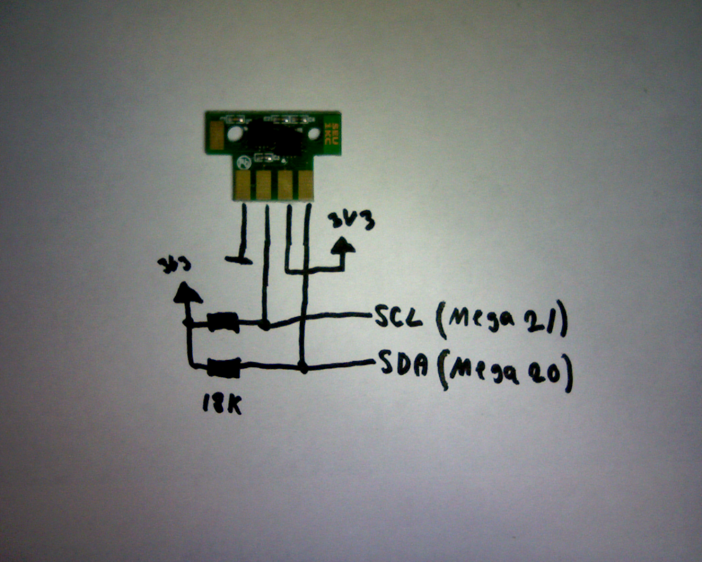

# ESP32 Toner Chip Resetter for Lexmark and compatible printers

This project provides a simple and effective solution for resetting the toner chip on various Lexmark printers using an ESP32 microcontroller. By resetting the chip, you can extend the life of your toner cartridges and reduce printing costs.

## Features

- **Toner Chip Reset:** Resets the page counter and toner level on the TI046B1 chip used in many Lexmark toner cartridges.
- **Simple Operation:** A single button press triggers the reset process.
- **Visual Feedback:** A WS2812B RGB LED provides clear status updates:
    - **Green:** Ready for operation.
    - **White:** Resetting Black cartridge.
    - **Cyan:** Resetting Cyan cartridge.
    - **Magenta:** Resetting Magenta cartridge.
    - **Yellow:** Resetting Yellow cartridge.
    - **Slow Blinking Red:** No cartridge detected.
    - **Fast Blinking Red:** Reset failed (read error, CRC mismatch, write error or verification mismatch). Check the serial log for details.
    - **Solid Red (5 seconds):** Nothing was written: the cartridge has reached end of life, or its chip is damaged (a data block has an invalid CRC, for example because the printer reported it as defective). The serial log says which (see [Printer behavior and limitations](#printer-behavior-and-limitations)).
- **Safe Writes:** Each data block is CRC-checked before it is modified and read back after writing to verify it. The process stops at the first failing block. Cartridges the printer has marked as end of life and damaged chips are not touched.
- **Automatic Backup:** Before every reset the chip's data blocks are saved in the ESP32's flash, keyed by the cartridge serial number. If the printer later reports the cartridge as defective, the `restore` command writes the backup back (see [Recovering a defective chip](#recovering-a-defective-chip)). The reset is not started if the backup cannot be saved.
- **Serial Diagnostics:** Read-only dump commands to inspect a chip, plus guarded write commands to restore a chip from a backup or a saved image (see [Serial commands](#serial-commands)).
- **PlatformIO Based:** Easy to build and upload using PlatformIO and Visual Studio Code.

## Compatible Printers

This tool is designed to work with printers that use toner cartridges with the TI046B1 chip. The following Lexmark printers are known to be compatible:

- CX310
- CX310dn
- CX410
- CX510
- CX410dte
- CX510de

It may also be compatible with other Lexmark, Dell, and Konica Minolta printers that use the same toner chip.

## Hardware Requirements

- **ESP32 Development Board:** A WEMOS LOLIN S2 Mini (ESP32-S2) is the default target. Classic ESP32 boards (e.g., ESP32-WROOM-32, ESP-WROVER-KIT) are supported through a second build environment.
- **Push Button:** A standard momentary push button.
- **WS2812B RGB LED:** A single addressable RGB LED (e.g., a NeoPixel).
- **Jumper Wires:** For connecting the components.

## Wiring

| Component      | LOLIN S2 Mini (`lolin_s2_mini`, default) | Classic ESP32 (`esp-wrover-kit`) |
| -------------- | ---------------------------------------- | -------------------------------- |
| I2C SDA        | GPIO 33                                  | GPIO 21                          |
| I2C SCL        | GPIO 35                                  | GPIO 22                          |
| Push Button    | GPIO 9                                   | GPIO 12                          |
| WS2812B LED    | GPIO 11                                  | GPIO 13                          |

**Button wiring:** On the LOLIN S2 Mini the button goes between GPIO 9 and 3.3V, with a pull-down resistor from GPIO 9 to GND (active HIGH). On classic ESP32 boards the button goes between GPIO 12 and GND and the internal pull-up is used (active LOW). The active level is set with `BUTTON_ACTIVE_LEVEL` in `platformio.ini`. A reset only starts after the button has been seen released, so a wrong active level cannot trigger a reset at boot; the boot log shows whether the button reads as released. The WS2812B LED's data pin goes to the LED pin. The I2C pins (SDA and SCL) are used to communicate with the toner chip.

On classic ESP32 boards GPIO 12 is a strapping pin (flash voltage select): do **not** add an external pull-up to it, or modules with 3.3V flash (e.g. ESP32-WROOM-32) will fail to boot.

Pins are set per board with `build_flags` in `platformio.ini`, so a different wiring only needs a change there.

## Chip Pinout

For SDA and SCL, a 10k pull-up resistor is used.

## How to Use

Reset a cartridge **before** the printer reports it as empty (at around 1-5% remaining). See [Printer behavior and limitations](#printer-behavior-and-limitations) for why.

1.  **Connect the ESP32 to the toner cartridge:** Connect the SDA and SCL pins of the ESP32 to the corresponding pins on the toner chip.
2.  **Power on the ESP32:** The LED will turn green, indicating that the device is ready.
3.  **Press the button:** The reset process will begin. The LED will change color based on the detected cartridge.
4.  **Wait for the process to complete:** On success the LED stays on the cartridge color for 2 seconds, then turns back to green. If no cartridge is detected, the LED blinks red slowly for 5 seconds. If the reset fails, the LED blinks red quickly for 5 seconds. If the cartridge has reached end of life or its chip is damaged, the LED stays solid red for 5 seconds and nothing is written.
5.  **Release the button:** A new reset only starts after the button has been released and pressed again.
6.  **Insert a different cartridge of the same color first:** Put any other cartridge of that color that the printer recognizes into the printer (it may be empty), let the printer detect it, then remove it.
7.  **Insert the reset cartridge:** The printer now reads the level from the chip and shows it as full.

If you skip step 6, the printer recognizes the cartridge as the one it already knows. It then either writes its remembered counters back to the chip and keeps showing the old level, or, when the cartridge was nearly empty, invalidates the chip and reports it as defective. A defective chip can be recovered, see [Recovering a defective chip](#recovering-a-defective-chip).

## Printer behavior and limitations

These observations come from tests on a Lexmark CX310dn (firmware LW80.GM2.P259). The printer's *Device Statistics* page (`http://<printer-ip>/cgi-bin/dynamic/printer/config/reports/devicestatistics.html`) shows per cartridge the install date, supply level and "Sides on Cart", which is handy to check the result of a reset.

- **The printer remembers cartridges by serial number.** When the same cartridge is reinserted right after a reset, the printer writes its remembered page counters back to the chip, undoing the reset. Inserting a different cartridge of the same color in between makes it read the chip again. The printer's "Sides on Cart" count for that serial number is kept even after a successful reset; the level shown comes from the chip.
- **A nearly empty cartridge reinserted right after a reset becomes "defective".** In one test a cartridge with little toner left was reset and reinserted without step 6. The printer reported "Defective" and filled both 56-byte blocks and the 208-byte block with `0xFF` (all CRCs invalid) and erased the chip ID copy at `0x160`. The factory area was untouched, and the cartridge was not end of life: after the chip was rebuilt and step 6 was followed, the printer accepted it as full.
- **End of life is permanent.** Once the printer has reported a cartridge as "End of Life", it keeps that state in its own memory, keyed by the cartridge serial number. Even a fully cleaned chip (and inserting it with the printer powered off) still shows "End of Life". The serial number is in the chip's read-only factory area and cannot be changed, so such a cartridge can only be reused with a replacement chip.
- **Resetting an end-of-life chip makes it "defective".** When a cartridge reaches end of life, the printer overwrites some identity fields on the chip with `0xFF`. A reset that leaves them in place is reported as "Missing or Defective", and the printer may then corrupt the chip's data blocks. The firmware therefore refuses to reset such a chip. From the chip alone, a cartridge that was invalidated *after* reaching end of life cannot be told apart from one that was invalidated before; only the printer knows.
- **High-yield chips:** in these tests two high-yield chips (`80C8HK0`, `80C8HCE`) were rejected with "Unsupported cartridge" (32.xx), while standard chips (`80C8SK0`) were accepted. The printer's own history shows a high-yield black was used in it before, so this is an observation, not a confirmed rule.

## Serial commands

The firmware accepts commands on the serial port (115200 baud, newline terminated). All values are hexadecimal.

| Command | Description |
| ------- | ----------- |
| `d` | Dump the serial number, both 56-byte blocks, the 208-byte block and the chip ID copy of every connected chip, with CRC check. Read-only. |
| `f` | Full hex dump of the whole 2 KB address space (`0x000`-`0x7FF`) of every connected chip, 16 bytes per line. Read-only. |
| `r <addr> <lo> <hi> <len>` | Raw read of `len` bytes at chip address `hi:lo` from the chip at I2C address `addr`, e.g. `r 1 40 4 c` reads the serial number of a black chip. Read-only. |
| `w <addr> <block> <data>` | Write one whole block (`20`, `58`, `90` or `160`) from hex data and verify it by reading it back. Blocks with a CRC must carry a valid one. Meant for restoring a chip from a saved dump; use with care. |
| `b` | List the serial numbers that have a backup saved in flash. Read-only. |
| `restore <addr>` | Write the backup saved for the serial number of the chip at I2C address `addr` back to that chip, block by block with verification, e.g. `restore 1` for a black chip. The chip's current content is not checked, so it also works on a damaged chip. |
| `forget <serial>` | Delete the backup of a serial number, e.g. when the flash is full. |

### Sharing a chip dump

To help investigate a cartridge (for example to compare chips of different regions or printer models), you can share a full dump of its chip. It only reads the chip, nothing is written.

1.  Flash the firmware and connect the cartridge chip as described above.
2.  Open a serial monitor at 115200 baud (for example the PlatformIO *Serial Monitor*, or the Arduino IDE Serial Monitor with line ending set to *Newline*).
3.  Type `f` and press Enter.
4.  Copy everything from `=== FULL DUMP` to `=== END FULL DUMP` and paste it into the GitHub issue, together with the printer model, the cartridge part number and region, and what the printer reports for it.

## Recovering a defective chip

If the printer reports a cartridge as defective and the firmware refuses to reset it (solid red, "A data block has an invalid CRC" in the serial log), first rule out a bad connection: reseat the wires and run `d` again. If the CRCs stay invalid, the printer has invalidated the chip.

**From the automatic backup (recommended):**

1.  Connect the chip and run `b` to check that its serial number is listed.
2.  Run `restore <addr>` (`1` black, `2` cyan, `3` magenta, `4` yellow). The chip is back in the state it had before the last reset.
3.  Reset it with the button, then follow steps 6 and 7 of [How to Use](#how-to-use).

**Without a backup (rebuilding from another chip):** the data blocks hold no cartridge-specific secrets, so they can be rebuilt from a healthy chip of the same part number. This worked for a black `80C8SK0` cartridge; other colors and part numbers are untested.

1.  Take a full dump (`f`) of the damaged chip and of a healthy chip with the same part number (`0x455`).
2.  Copy the healthy chip's 56-byte block (`0x020`) and put the damaged chip's own model code (its byte at `0x451`) at index 21. Recalculate the CRC16 of bytes 0-53 into bytes 54-55. Use the result for both `0x020` and `0x058`.
3.  For the 208-byte block (`0x090`) use zeros, a 30-byte UUID at bytes 169-198 (the damaged chip's own UUID if it is still there), zeros up to byte 205, and the CRC16 of bytes 0-205 in bytes 206-207.
4.  For the chip ID copy (`0x160`) use the damaged chip's own chip ID (`0x400`-`0x405`) followed by ten zero bytes.
5.  Write the four blocks with `w <addr> <block> <data>`, run `d` to check that all CRCs are valid, then follow steps 6 and 7 of [How to Use](#how-to-use).

If the printer still shows "End of Life" afterwards, it has recorded the cartridge as used up; see [Printer behavior and limitations](#printer-behavior-and-limitations).

## Chip memory map

The chip uses 16-bit addresses; the read command is `0x01, low, high`, the write command `0x02, low, high`. Reads are word aligned (an odd address reads from the even address below it).

| Address | Size | Content |
| ------- | ---- | ------- |
| `0x020` | 56 | Toner level, status and counters (bytes 15-16: pages, byte 22: model code, a copy of `0x451`, bytes 50-51: "Sides on Cart"), CRC16 in the last 2 bytes |
| `0x058` | 56 | Copy of the block above |
| `0x090` | 208 | Usage data and a 30-byte UUID (bytes 170-199), CRC16 in the last 2 bytes |
| `0x160` | 16 | Copy of the 6-byte chip ID (`0x400`-`0x405`) followed by zeros; erased to `0xFF` by the printer at end of life |
| `0x400`-`0x6FF` | | Read-only factory area: chip ID (`0x400`), serial number (`0x440`), model code (`0x451`), part number (`0x455`), page yield (`0x49A`), signature-like data |

## Building and Uploading

This project is configured for PlatformIO.

1.  **Install Visual Studio Code and PlatformIO:** If you haven't already, install VS Code and the PlatformIO IDE extension.
2.  **Open the project:** Open this project folder in Visual Studio Code.
3.  **Build and Upload:** Click the "Upload" button in the PlatformIO toolbar at the bottom of the VS Code window. PlatformIO will automatically handle the dependencies and upload the firmware to your ESP32. The `lolin_s2_mini` environment is built by default; select `esp-wrover-kit` for a classic ESP32 board.

**LOLIN S2 Mini first upload:** If the board is not detected, put it into download mode: hold the `0` button, press and release `RST`, then release `0`. After uploading, press `RST` to start the firmware. The serial log is available over the board's native USB port at 115200 baud.

## Disclaimer

This project is for educational purposes only. Use it at your own risk. The author is not responsible for any damage to your printer or toner cartridges.

## References

This project is based on the research and work of the Pori Hacklab. For more information, please visit their blog post:
[https://pori.hacklab.fi/wordpress/?p=1114](https://pori.hacklab.fi/wordpress/?p=1114)

Further findings on the TI046B1 chip are collected in the EEVblog forum thread [Lexmark toner chip Ti046b1](https://www.eevblog.com/forum/projects/lexmark-toner-chip-ti046b1/).
